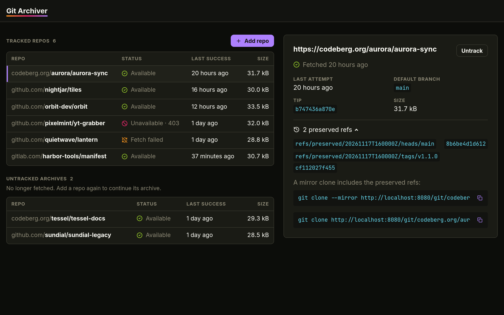
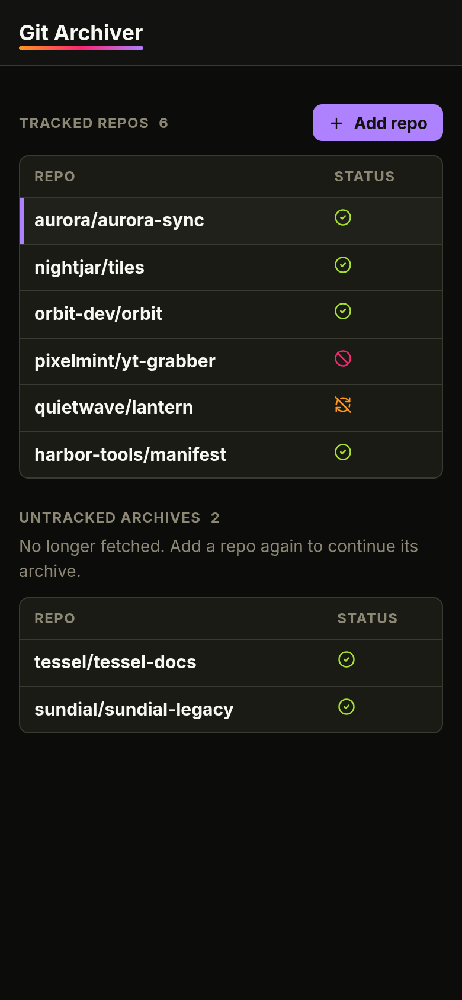

# Git Archiver

Git Archiver is a small self-hosted service that keeps local copies of public git repositories, so their history survives takedowns, deletions and rewrites upstream.

You list the repos you care about. These are the **tracked repos**. Within a global **interval** (24 hours by default), the app **fetches** each one once into its **archive**: a plain bare git repository holding the repo's default branch and tags. Fetches are spread evenly across the interval and run one at a time.

Upstream can lose history. Someone force-pushes the default branch, moves or deletes a tag, or switches the default branch to another branch. Each of these is a **rewrite**. When a fetch sees a rewrite, it keeps the old tip as a **preserved ref** inside the archive, forever, before taking the new state.

Every tracked repo has one of three statuses:

- **Available**: the last fetch succeeded.
- **Unavailable**: upstream refused the repo with a 4xx response, such as a DMCA takedown or a deleted repo (except 408 and 429, which only ask to come back later). The archive is left untouched, and the repo keeps being fetched, so it becomes Available again if upstream restores it.
- **Fetch failed**: a transient problem such as a 5xx response, a 408 or 429, a network error or a timeout. It says nothing about the repo's fate, never touches the archive, and is retried at the repo's next turn.

A web UI lists every archive with its status, tip and preserved refs, and gives each repo its own page at `/repos/<host>/<path>`, such as `/repos/github.com/owner/repo`. You can add repos there or untrack them. With JavaScript on, open pages update themselves as fetches finish and repos come and go. Archives can be cloned read-only over HTTP, and `/metrics` exposes everything to Prometheus.

The terms in bold are defined in [`CONTEXT.md`](CONTEXT.md).

<p align="center">
  
  
</p>

> [!WARNING]
> **Git Archiver has no authentication.** The web UI, `/metrics` and the git endpoint are open to anyone who can reach the port. Anyone who can reach it can add repos, untrack them and delete archives.
>
> **Serving archives republishes them.** Anyone who can reach the port can clone every archive, including repos that upstream took down, and their preserved refs. If you expose the port, you are distributing that content yourself and may receive takedown notices for it.
>
> Keep the port on localhost or a private network, or put it behind a reverse proxy that adds authentication. See the research notes on [storage and distribution](docs/research/git-archiving-prior-art.md#5-storage-and-distribution-options) and the [legal landscape](docs/research/git-archiving-prior-art.md#6-legal-landscape-factual-not-legal-advice) (§5–6) for context. They are not legal advice.

## Running it

Git Archiver keeps everything in one data directory: its config, its state and the archives. On first start it creates the directory and writes a commented default config into it. To move the app or keep a copy of everything, copy that one directory.

```text
<data dir>/
├── config.toml          # your settings, written on first start
├── state.json           # last fetch, status and size per archive
└── repos/
    └── github.com/
        └── owner/
            └── repo.git # one bare git repo per archive
```

### Container

The image is published to `ghcr.io/marcusleg/git-archiver` for `linux/amd64` and `linux/arm64`. It includes `git`, runs as the non-root user `archiver` (uid 10001), uses `/data` as the data directory and listens on port 8080.

```sh
docker run -d --name git-archiver --restart unless-stopped \
  -p 127.0.0.1:8080:8080 \
  -v git-archiver-data:/data \
  ghcr.io/marcusleg/git-archiver:latest
```

Open http://localhost:8080. The example publishes the port on localhost only. Change `127.0.0.1:8080:8080` to `8080:8080` to expose it to your network, but read the warning above first.

To edit `config.toml` with your own editor, mount a host directory instead of a named volume. The app runs as uid 10001, so that user must own the directory:

```sh
mkdir -p /srv/git-archiver
sudo chown 10001:10001 /srv/git-archiver
docker run -d --name git-archiver --restart unless-stopped \
  -p 127.0.0.1:8080:8080 \
  -v /srv/git-archiver:/data \
  ghcr.io/marcusleg/git-archiver:latest
```

Keep `listen` in the config at its default of `0.0.0.0:8080` inside the container, and choose where the port is reachable with `-p`.

To build the image yourself, run `docker build -t git-archiver .`.

### Binary

Each [release](https://github.com/marcusleg/git-archiver/releases) has static binaries for Linux amd64 and arm64. They run on any Linux host with `git` installed, and need nothing else. The git endpoint runs `git http-backend`, which some distributions package separately, such as `git-daemon` on Alpine.

```sh
version=v0.1.0   # the release you want
arch=amd64       # or arm64
curl -fsSLO "https://github.com/marcusleg/git-archiver/releases/download/$version/git-archiver-$version-linux-$arch.tar.gz"
tar -xzf "git-archiver-$version-linux-$arch.tar.gz"
sudo install "git-archiver-$version-linux-$arch/git-archiver" /usr/local/bin/

git-archiver --data-dir /var/lib/git-archiver
```

The binary listens on `0.0.0.0:8080` by default, so it is reachable from your whole network. To keep it local, set `listen = "127.0.0.1:8080"` in `config.toml` and restart.

To run it as a systemd service, use a unit like this one:

```ini
# /etc/systemd/system/git-archiver.service
[Unit]
Description=Git Archiver
After=network-online.target
Wants=network-online.target

[Service]
ExecStart=/usr/local/bin/git-archiver
Environment=GIT_ARCHIVER_DATA_DIR=/var/lib/git-archiver
StateDirectory=git-archiver
DynamicUser=yes
Restart=on-failure

[Install]
WantedBy=multi-user.target
```

To build the binary from source, install a Rust toolchain and run `cargo build --release`. The binary is `target/release/git-archiver`.

### Command line and environment

| Option | Environment variable | Meaning |
|---|---|---|
| `--data-dir <DIR>` | `GIT_ARCHIVER_DATA_DIR` | The data directory. Required. The container sets it to `/data`. |
| | `RUST_LOG` | Log level or filter, such as `debug` or `git_archiver=debug`. The default is `info`. |

Every other setting lives in `config.toml`.

## Configuration

`config.toml` is a TOML file in the data directory. The app writes it on first start with every setting at its default value, and never overwrites it.

```toml
interval = "24h"
listen = "0.0.0.0:8080"

repos = [
  "https://github.com/owner/repo",
  "https://codeberg.org/owner/other-repo",
]

[hosts."github.com"]
token = "ghp_..."
```

| Setting | Default | Meaning |
|---|---|---|
| `interval` | `"24h"` | The period within which every tracked repo is fetched once. Fetches are spread evenly across it, one repo at a time. The repo whose last attempt is oldest goes first, whether that attempt succeeded or not. A duration such as `"24h"`, `"90m"` or `"1h 30m"`. |
| `listen` | `"0.0.0.0:8080"` | The IP address and port for the web UI, `/metrics` and the git endpoint. |
| `repos` | `[]` | The URLs of the tracked repos. Only `http://` and `https://` URLs are allowed, without credentials in them. URLs that differ only in the host's case, a trailing `.git` or trailing slashes are the same repo and share one archive. |
| `hosts."<host>".token` | none | An optional token for one host, such as `github.com`. It is used only when fetching from that host, for example to avoid anonymous clone rate limits, and is never shown in the UI, logs or metrics. |

You can edit `config.toml` while the app runs. The app re-reads the repo list before every fetch, and at least once a minute. Changes to `interval` and `listen` take effect on restart. If you save an invalid file, the app keeps running on the last good config, logs an error and shows a warning in the UI until the file is valid again.

Adding a repo in the UI writes it into `config.toml`, and keeps your comments and formatting. A newly added repo is cloned right away.

**Untracking** a repo stops fetching it. Removing a repo from `config.toml` by hand only untracks it and never deletes its archive. When you untrack a repo in the UI, you choose whether to keep the archive or delete it. A kept archive is listed as an **untracked archive**, and tracking the same repo again continues it.

## Cloning archives

Every archive, tracked or not, can be cloned read-only from the git endpoint under `/git/`. The UI shows a ready-to-copy clone command for each one:

```sh
git clone http://localhost:8080/git/github.com/owner/repo.git
```

A plain clone gets the default branch and tags. To get the preserved refs too, clone with `--mirror`, or fetch them into an existing clone:

```sh
git clone --mirror http://localhost:8080/git/github.com/owner/repo.git
# or, inside a clone:
git fetch origin 'refs/preserved/*:refs/preserved/*'
```

When an archive has preserved refs, its card offers the mirror clone command too, under the expanded list of preserved refs.

Preserved refs are named `refs/preserved/<UTC time of the rewrite>/heads/<branch>` or `refs/preserved/<UTC time of the rewrite>/tags/<tag>`.

The endpoint refuses pushes. Each archive is also an ordinary bare repo in `repos/` in the data directory, so you can inspect or recover it with plain `git` even without the app.

The clone commands in the UI use the host and port your browser reached the app on. Behind a reverse proxy, their scheme follows the `X-Forwarded-Proto` or `Forwarded: proto=` header, which most reverse proxies set, so a proxy that serves the app over HTTPS gets `https://` commands. Without either header, the commands use `http://`.

Open pages learn of changes over a Server-Sent Events stream at `/events`, which stays open as long as the page does. The app sends `X-Accel-Buffering: no` so nginx passes events on as they come; another proxy may need response buffering turned off for that path, and a read timeout longer than the stream's 30-second heartbeat.

## Metrics

`/metrics` serves Prometheus metrics in the text format. Per-repo metrics carry a `repo` label holding the repo's normalized URL, such as `https://github.com/owner/repo`.

| Metric | Type | Meaning |
|---|---|---|
| `archiver_repo_status{repo, status}` | gauge | 1 for the repo's current status, 0 for the others. `status` is `available`, `unavailable` or `fetch_failed`. |
| `archiver_repo_last_success_timestamp_seconds{repo}` | gauge | When the repo was last fetched successfully, in Unix seconds. |
| `archiver_repo_preserved_refs{repo}` | gauge | How many preserved refs the archive holds. |
| `archiver_repo_size_bytes{repo}` | gauge | The archive's size on disk, measured after each fetch. |
| `archiver_repo_tracked{repo}` | gauge | 1 for a tracked repo, 0 for an untracked archive. |
| `archiver_next_fetch_timestamp_seconds` | gauge | When the next fetch is due, in Unix seconds. |
| `archiver_fetch_duration_seconds` | gauge | How long the last fetch took. |
| `archiver_rewrites_total` | counter | Fetches that found a rewrite upstream and preserved the old tips, since the app started. |
| `archiver_fetch_errors_total{status}` | counter | Failed fetches since the app started, by the status they led to: `unavailable` or `fetch_failed`. |

Example alerts:

```yaml
- alert: RepoUnavailable
  expr: archiver_repo_status{status="unavailable"} == 1
- alert: ArchiveStale
  expr: time() - archiver_repo_last_success_timestamp_seconds > 3 * 86400
- alert: UpstreamRewrite
  expr: increase(archiver_rewrites_total[1d]) > 0
```

Logs go to stdout. Every status change and every rewrite is logged with the repo and the preserved ref names, so you can alert on them from your log tooling too.

## Testing

`cargo test` runs the whole suite. It needs `git`, and Chrome or Chromium for the tests that drive the list page in a real headless browser. The browser is the first of `chromium`, `chromium-browser`, `google-chrome`, `google-chrome-stable` and `chrome` found on `PATH`; set `GIT_ARCHIVER_TEST_BROWSER` to a path or command name to pick another. Without one, those tests fail rather than skip.

### Screenshots

The screenshots above come from `scripts/update-screenshots.sh`, which runs the app against fake repos and photographs the list page in the same headless browser as the tests. The [screenshots workflow](.github/workflows/screenshots.yml) runs it after UI changes land on `main`, or on demand, and opens a pull request when the screenshots changed.

## Releasing

Push a tag that matches the version in `Cargo.toml`, such as `v0.1.0`. The [release workflow](.github/workflows/release.yml) builds the amd64 and arm64 binaries and the container image, smoke-tests the image, publishes the image to GHCR and attaches the binaries to a GitHub release. A tag with a suffix, such as `v0.2.0-rc.1`, makes a pre-release that doesn't move `latest`.

## License

[MIT](LICENSE)
